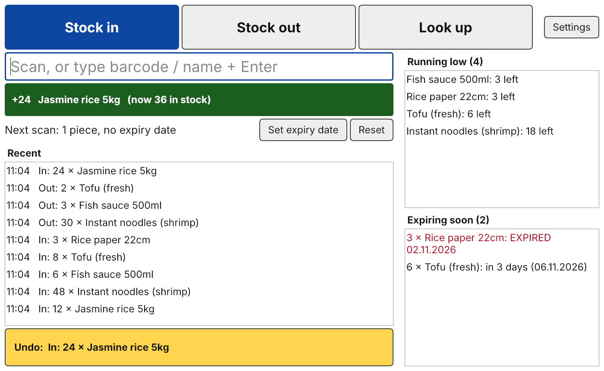

# Shop Inventory

A small desktop program to keep track of the stock of a grocery shop.
C++17, Qt 6 Widgets, SQLite, CMake, Qt Test.

Built for one user who is not good with computers:
one window, three big buttons, no Save button, a big Undo button,
daily automatic backup.



## How to use

| Button | What happens when you scan |
|---|---|
| **Stock in** | +1 (or the number typed before). Unknown barcode opens "New product". |
| **Stock out** | -1 (or the number typed before), taken from the batch that expires first. |
| **Look up** | Shows the product, its stock and its batches. |

In every mode the input field accepts:

- a scan, or a barcode typed by hand, then Enter
- a small number (1-4 digits), then Enter: quantity for the next scan
- part of a name, then Enter: a list of products to click

The right side always shows **Running low** and **Expiring soon**.

## Build

Needs Qt 6 (Core, Sql, Widgets, Test) and CMake 3.21+.

- Qt Creator: open `CMakeLists.txt`, press Build, run tests from the Tests panel.
- Command line:

  ```
  cmake -S . -B build
  cmake --build build
  cd build && ctest --output-on-failure
  ```

Windows package: see `packaging/windows/deploy.bat`.

## Project layout

```
src/core/   business logic, links only QtCore + QtSql (no GUI possible)
  Database           opens SQLite, foreign keys on, schema migrations
  InventoryService   products, stock in/out, undo, history
  AlertService       low stock, expiring soon
  InputClassifier    what the typed/scanned text means; EAN check digit
  Backup             daily VACUUM INTO, keeps the newest 30
src/app/    Qt Widgets user interface
  MainWindow         the one window
  Dialogs            new/edit product, expiry date, settings
  KeyRedirector      sends stray key presses back to the input field
  main.cpp           single instance lock, data folder, backup timer
tests/      Qt Test, one executable per class, real SQLite in memory
docs/       assumptions.md
```

## Design decisions (short)

1. **Ledger instead of a stock number.** Stock is never stored; it is
   `SUM(movements.quantity)`. History comes for free and can never disagree
   with the stock.
2. **Undo writes, it does not delete.** An undo is a new operation with the
   opposite movements. `reverses_id UNIQUE` makes a double undo impossible.
   Undo always takes the newest action not undone yet, so stock can never go
   negative because of an undo.
3. **One transaction per action.** That is what makes "no Save button" safe:
   a power cut loses at most the action in progress, never half of it.
4. **Batches + first expired, first out.** Each delivery keeps its own
   expiry date; stock out empties the earliest one first.
5. **One input field for scanner and keyboard.** The scanner is just a fast
   keyboard. Buttons and lists never take the focus, and `KeyRedirector`
   brings stray keys back, so no scan is lost.
6. **The database enforces the rules** (`UNIQUE`, `CHECK`, foreign keys),
   not only the C++ code.
7. **No threads.** Every query here takes milliseconds.
8. **Testable without a clock or hardware.** `AlertService` and `Backup`
   take "today" as a parameter; input rules are pure functions.

Data lives in the user's AppData folder (`inventory.db`, `backups/`).

## Backup and restore

- **Backup** happens by itself: once a day, at start or within the hour,
  into `backups/` or the folder chosen in Settings. The newest 30 are kept.
  Choose a USB stick or cloud folder in Settings, so a broken disk does not
  take the backups with it.
- **Restore** (in the program): Settings → *Restore from backup...* → pick a
  file `inventory-YYYY-MM-DD.db` → confirm.
  The current data is kept as `before-restore-<date-time>.db` next to
  `inventory.db`, so a wrong choice can be undone by restoring that file.
- **New computer** after the old one broke: install the program, start it
  once (it starts empty), then restore from the USB stick or cloud folder.
- **By hand** (program closed): copy a backup file into the data folder and
  rename it to `inventory.db`.
